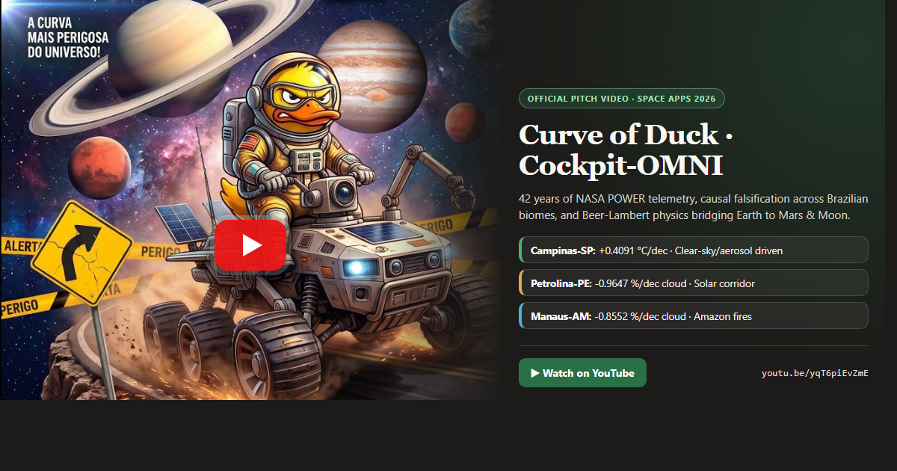
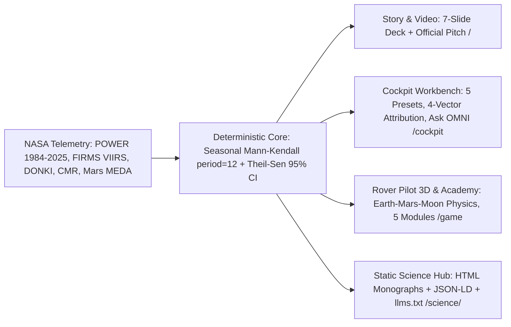

<div align="center">

# Cockpit-OMNI · Curve of Duck

### NASA Space Apps Challenge 2026 — Challenge #2: *Be An Earth System Trend Detective!*

**Team Curva do Pato** · Lead Author: **Luiz Antonio Gois Junior** · Campinas, SP, Brazil

<p>
  <a href="https://www.curveofduck.xyz/"></a>
  <a href="https://youtu.be/yqT6piEvZmE"></a>
  <a href="https://www.curveofduck.xyz/science/"></a>
  <a href="https://www.curveofduck.xyz/llms.txt"></a>
  <a href="./LICENSE"></a>
</p>

<p>
  <a href="https://www.curveofduck.xyz/">Story</a> ·
  <a href="https://www.curveofduck.xyz/cockpit">Cockpit Workbench</a> ·
  <a href="https://www.curveofduck.xyz/game">3D Rover Pilot &amp; Academy</a> ·
  <a href="https://www.curveofduck.xyz/science/">Science Hub</a> ·
  <a href="https://www.curveofduck.xyz/science/tendencias-climaticas-brasil-1984-2025/">Guia PT-BR</a> ·
  <a href="https://www.curveofduck.xyz/llms-full.txt"><code>llms-full.txt</code></a> ·
  <a href="./CITATION.cff">Cite (CFF)</a>
</p>

<br />

<a href="https://youtu.be/yqT6piEvZmE" title="Watch Curve of Duck | NASA Space Apps Challenge 2026 on YouTube">
  
</a>

<br />

**Official Presentation Video:** [Watch *Curve of Duck \| NASA Space Apps Challenge 2026* on YouTube (`https://youtu.be/yqT6piEvZmE`)](https://youtu.be/yqT6piEvZmE)

</div>

---

**Cockpit-OMNI** is an open-source, zero-key, statistically audited NASA Earth observation and trend attribution platform built in **Campinas, SP, Brazil**. Given any geographic region and Earth system variable, it retrieves 42-year satellite and reanalysis time series (**NASA POWER `1984–2025`, `n = 504` continuous monthly observations**), tests significance using **Seasonal & Original Mann-Kendall** plus **deseasonalized Theil-Sen slopes with 95% confidence intervals**, and attributes shifts across four physical vectors with explicit operational labels (`live`, `cached`, or `roadmap`).

> [!IMPORTANT]
> **Runtime Hypothesis Falsification (Same Statistical Engine, Opposite Causal Verdicts):**
> Surface solar brightening can result from **fewer clouds** or from **aerosol/clear-sky transparency shifts**. Cockpit-OMNI computes the exact verdict at runtime from cached and live NASA POWER series without hardcoding regional answers: **Campinas-SP** brightens via clear-sky irradiance (`p < 1e-16`) with flat clouds (`p = 0.948`), whereas **Petrolina-PE** (`p = 2.83e-09`) and **Manaus-AM** (`p = 3.02e-08`) brighten due to declining cloud attenuation while clear-sky irradiance shows no trend.

---

## Brazilian Biome Scorecard (`1984–2025`, `n = 504` Months)

| Region & Coordinates | Biome Context | 2m Temperature (`T2M`) | Cloud Attenuation (`CLOUD_ATTEN_PCT`) | Clear-Sky SW (`CLRSKY_SFC_SW_DWN`) | Causal Verdict |
|---|---|---|---|---|---|
| **Campinas-SP**<br />`-22.90, -47.06` | Atlantic Forest / Cerrado Transition | **`+0.4091 °C/dec`**<br />`95% CI [+0.3329, +0.4891]`<br />`+1.718 °C` total · `p < 1e-16` | `+0.0378 %/dec`<br />**`p = 0.9476` (Null)** | **`+0.1897 MJ/m²/day/dec`**<br />**`p < 1e-16` (Significant)** | **Aerosol / Clear-Sky Driven** |
| **Petrolina-PE**<br />`-9.39, -40.50` | Caatinga Semi-Arid Solar Corridor | **`+0.3012 °C/dec`**<br />`95% CI [+0.2314, +0.3710]`<br />`+1.265 °C` total · `p = 4.66e-15` | **`-0.9647 %/dec`**<br />**`p = 2.83e-09` (Significant)** | `+0.0127 MJ/m²/day/dec`<br />**`p = 0.2901` (Null)** | **Cloud-Driven Brightening** |
| **Manaus-AM**<br />`-3.10, -60.02` | Central Amazon Rainforest | **`+0.3065 °C/dec`**<br />`95% CI [+0.2543, +0.3593]`<br />`+1.287 °C` total · `p < 1e-16` | **`-0.8552 %/dec`**<br />**`p = 3.02e-08` (Significant)** | `+0.0289 MJ/m²/day/dec`<br />**`p = 0.7686` (Null)** | **Cloud-Driven Brightening** |

> [!WARNING]
> **Declared Scientific Limitation (`WS2M` Monthly Wind Resolution):**
> Monthly 2m wind speed (`WS2M`) shows **no statistically significant trend** at any station (**Campinas `p = 0.489`**, **Petrolina `p = 0.173`**, **Manaus `p = 0.451`**) and smooths out sub-hourly wind gusts. This dataset is **not valid for sub-hourly ramp-risk or battery-dispatch claims**. Cockpit-OMNI keeps such claims out of the product and explicitly marks the grid-ramp persona row **"Not supported"** in the UI.

---

## System & Attribution Flow



---

## Who Acts on These Numbers

| Persona | Decision It Changes | Audited Evidence (`1984–2025`, `n = 504`) |
|---|---|---|
| **Civil Defense / Urban Planning** | Size heat-wave response for a multi-decade warming baseline in Campinas | `+0.409 °C/dec` ≈ **+1.72 °C cumulative**, `95% CI [+0.333, +0.489]`, `p < 1e-16`; rainfall `-0.272 mm/day/dec`, `RH2M` `-1.660 %/dec` |
| **Solar Generation Planner (NE Corridor)** | Decide whether rising irradiance in Petrolina is clear-sky improvement or fewer clouds | Cloud attenuation `-0.965 %/dec` (`p = 2.83e-09`) with clear-sky null (`p = 0.290`) |
| **Air Quality & Fire Response (Amazon)** | Separate smoke-driven aerosol forcing from cloud-cover reduction & sharp rainfall drop | Cloud `-0.855 %/dec` (`p = 3.02e-08`), clear-sky null (`p = 0.769`), `PRECTOTCORR` `-0.467 mm/day/dec` (`p = 4.24e-11`) |
| **Grid Ramp / Storage Operator** | Pre-position storage ahead of an intra-hour wind ramp | **Not supported** — monthly `WS2M` `p = 0.489 / 0.173 / 0.451`; requires hourly measurements |

---

## Challenge #2 Requirements — Item-by-Item Coverage

| Requirement | Implementation in Cockpit-OMNI |
|---|---|
| **1. Earth System Variable(s)** | 2m Air Temperature (`T2M`, °C), Bias-Corrected Precipitation (`PRECTOTCORR`, mm/day), All-Sky & Clear-Sky Surface Shortwave Irradiance (`ALLSKY_SFC_SW_DWN`, `CLRSKY_SFC_SW_DWN`, MJ/m²/day), 2m Relative Humidity (`RH2M`, %), 2m Wind Speed (`WS2M`, m/s), plus derived **Cloud Attenuation Deficit** (`1 - ALLSKY/CLRSKY`). |
| **2. Specific Region(s)** | Preset monitoring stations across three Brazilian biomes — **Campinas-SP** (`-22.90, -47.06`), **Petrolina-PE** (`-9.39, -40.50`), and **Manaus-AM** (`-3.10, -60.02`) — plus arbitrary `(lat, lon)` coordinate queries via open NASA POWER CORS. |
| **3. Long-Term Time Series** | 42-year continuous monthly records (`1984–2025`, `504` monthly observations per variable) fetched from **NASA POWER** (`MERRA-2` & `CERES`). |
| **4. Rate of Change & Significance Testing** | **Seasonal Mann-Kendall** (`period=12`), **Original Mann-Kendall** (`τ`, `p-value`, verdict at `α = 0.05`), and **Deseasonalized Theil-Sen estimator** (`slope/decade`, 95% confidence interval, cumulative 42-year shift). |

---

## Multi-Vector Attribution Architecture

| Vector | Physical Signal | Data Source | Status |
|---|---|---|---|
| **Hydrometeorological** | Precipitation (`PRECTOTCORR`), humidity (`RH2M`), and All-Sky vs. Clear-Sky cloud attenuation | NASA POWER (`MERRA-2 / CERES`) · CORS zero-key | `live` |
| **Fire & Aerosol** | Active thermal anomalies, Fire Radiative Power (`FRP`), Haversine 150 km scan, Clear-Sky shortwave shifts | NASA FIRMS (`VIIRS_NOAA21_NRT`) · CMR `C3264430167-LANCEMODIS` | `live` |
| **Heliophysical** | Solar flares, coronal mass ejections, and geomagnetic storm alerts | NASA DONKI (`api.nasa.gov`) | `live` |
| **Geothermal & Surface Deformation** | Interferometric surface displacement & land surface temperature | NASA NISAR (`NISAR_L2_GUNW_PROVISIONAL_V1`) & ECOSTRESS via CMR | `roadmap` |

> [!NOTE]
> **Galactic / Local Impact Analog:** The same radiative attenuation law (Beer-Lambert `100 * exp(-0.55 * tau)`) connects Brazilian wildfire smoke and cloud swings directly to extraterrestrial habitat and rover survivability (**NASA Mars 2020 MEDA** `Sol 40` / `Sol 1100`, **NASA OSDR `OSD-615`**, **NASA DSN Now**, **CelesTrak GP**, and **JPL Horizons** ephemeris clients).

---

## Four-Intent Open Web Architecture (`EN | PT-BR`)

1. **Story & Presentation (`/`)** — 7-slide full-screen interactive deck ([`story.js`](./frontend/src/content/story.js) → [`docs/pitch_deck.html`](./docs/pitch_deck.html)) with continuously interpolated Duck Curve SVG, Conceptual Seasonal Toggle, keyboard/swipe controls, Present mode (`F`), plus the **embedded Official Presentation Video (`https://youtu.be/yqT6piEvZmE`)** immediately below the fold.
2. **Cockpit Workbench (`/cockpit`)** — Five operational tabs (*Trends & Action Presets | Attribution | Sources & Method | Live NASA FIRMS & DONKI | Space Analog MPTO*) with deterministic `GREEN / AMBER / RED` citizen presets, interactive `<GlossaryTooltip />` popovers, ~50 ms browser Seasonal Mann-Kendall, 504-row CSV/JSON exports, and the zero-key bilingual **`Ask OMNI`** assistant ([`askEngine.js`](./frontend/src/engine/askEngine.js)).
3. **3D Game & Detective Academy (`/game`)** — Lazy-loaded Three.js WebGL simulator (*Curve of Duck: Rover Pilot 3D*) across **Earth** (`Campinas`, `Petrolina`, `Manaus`), **Mars** (`Jezero Crater`), and **Moon** (`South Pole Artemis`), paired with the offline `localStorage` **Trend Detective Academy** (`M1–M5`, `>= 0.80` unassisted mastery gate, 1200×800 PNG diploma, `"Forget me"` privacy clear; `/academy` cleanly 301-redirects here).
4. **Citable Science Hub & GEO Layer (`/science/` · `/llms.txt` · `/llms-full.txt`)** — Static non-JS HTML monographs in English and Portuguese (`lang="pt-BR"`), machine-readable JSON caches, and valid `Schema.org` JSON-LD (`Organization`, `WebSite`, `SoftwareApplication`, `VideoObject`, `ScholarlyArticle`, `Dataset`, `FAQPage`).

---

## Verified Benchmark Highlights

- **Campinas-SP (`-22.90, -47.06`):** `T2M` `+0.4091 °C/dec` (`95% CI: [+0.3329, +0.4891]`, `τ = +0.293`, `p < 1e-16`), `PRECTOTCORR` `-0.2724 mm/day/dec` (`p = 1.59e-06`), `RH2M` `-1.6601 %/dec` (`p < 1e-16`), `CLRSKY` `+0.1897 MJ/m²/day/dec` (`p < 1e-16`), `CLOUD_ATTEN_PCT` null (`p = 0.9476`).
- **Petrolina-PE (`-9.39, -40.50`):** `T2M` `+0.3012 °C/dec` (`p = 4.663e-15`), `CLOUD_ATTEN_PCT` `-0.9647 %/dec` (`p = 2.833e-09`), `CLRSKY` null (`p = 0.2901`).
- **Manaus-AM (`-3.10, -60.02`):** `T2M` `+0.3065 °C/dec` (`p < 1e-16`), `PRECTOTCORR` `-0.4673 mm/day/dec` (`p = 4.238e-11`), `CLOUD_ATTEN_PCT` `-0.8552 %/dec` (`p = 3.015e-08`), `CLRSKY` null (`p = 0.7686`).

---

## Quickstart & Repository Structure

### 1. Run Frontend Immediately (Zero API Keys Required)

```bash
git clone https://github.com/SunLuiz/Curva_do_Pato.git
cd Curva_do_Pato
npm --prefix frontend install
npm --prefix frontend run dev
```

<details>
<summary><strong>Optional FastAPI Backend (`port 8000`) & Full Directory Tree</strong></summary>

```bash
cp .env.example .env           # Optional free NASA keys: NASA_API_KEY, FIRMS_MAP_KEY (see docs/OPERATIONAL_GUIDE.md)
.venv/Scripts/python.exe -m uvicorn app.main:app --app-dir backend --reload --port 8000
```

```text
Curva_do_Pato/                     # repository root
├── backend/                       # Optional FastAPI server, Python Mann-Kendall + Theil-Sen, NASA API clients
├── data/                          # Frozen fallback JSON/CSV snapshots (NASA POWER, FIRMS, DONKI, space_analog)
├── docs/                          # 100% English engineering guides, architecture specs & visual assets
│   ├── assets/                    # README presentation video card artwork
│   ├── OPERATIONAL_GUIDE.md       # Step-by-step runbook & local API key / endpoint routing matrix
│   ├── AGENTIC_PLANETARY_GUIDE.md # 6-step playbook for expanding PLANETS (Europa, Io, Titan, Triton)
│   ├── arquitetura_game3d_rover_pilot.md
│   └── pitch_deck.html            # Standalone 7-slide HTML deck generated from story.js
├── frontend/                      # Vite + React 19 SPA, Three.js 3D Rover, static /science/ monographs & prerender
├── scripts/                       # bake_game_data.py, build_deck.mjs, check_contrast.mjs, verify_answers.mjs
├── AGENTS.md / CLAUDE.md          # Guardrails & verification protocol
├── CITATION.cff                   # Academic software citation metadata
├── REFERENCES.md                  # Full NASA & external dataset citations
└── AI_DISCLOSURE.md               # Transparent AI usage declaration
```

</details>

<details>
<summary><strong>Verification, Contrast & Production Build Audit Suite</strong></summary>

```bash
.venv/Scripts/python.exe -m pytest backend/tests -q
node --test frontend/src/engine/askEngine.test.mjs frontend/src/engine/mptoEngine.test.mjs frontend/src/content/story.test.mjs frontend/src/content/routeMeta.test.mjs frontend/src/engine/trend.test.mjs frontend/src/academy/mastery.test.mjs frontend/src/engine/presets.test.mjs frontend/src/engine/ranking.test.mjs frontend/src/game/sim/sim.test.mjs
node scripts/check_contrast.mjs --css frontend/src/styles.css
node scripts/verify_answers.mjs
npm --prefix frontend run build
```

- **Full Operational & API Key Guide:** [docs/OPERATIONAL_GUIDE.md](./docs/OPERATIONAL_GUIDE.md)
- **Planetary Expansion Playbook:** [docs/AGENTIC_PLANETARY_GUIDE.md](./docs/AGENTIC_PLANETARY_GUIDE.md)

</details>

---

## Scientific & Branding Notice

- **Prototype Disclaimer:** Statistical trends and attribution scores generated by Cockpit-OMNI are comparative prototype estimates computed from historical open NASA datasets and should not replace certified meteorological or grid-dispatch advisories.
- **Data Attribution & Branding:** Built at **NASA Space Apps Challenge 2026 — Campinas**. This project uses open NASA datasets cited explicitly in [REFERENCES.md](./REFERENCES.md) and follows official Space Apps branding guidelines (no NASA insignia/logo is used).
- **AI Transparency:** See [AI_DISCLOSURE.md](./AI_DISCLOSURE.md).
