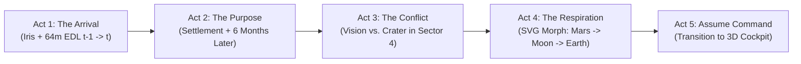
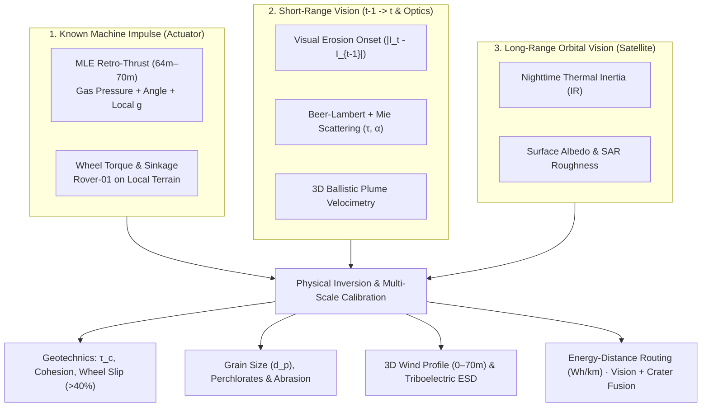

# 🎮 Game Design & Step-by-Step Engineering Architecture — *Curve of Duck: Rover Pilot 3D*

> [!IMPORTANT]
> **Scientific Rigor & Auditable Honesty (Golden Rule of the Repository)**
> Every design and implementation choice below strictly separates:
> 1. **Real Frozen Telemetry in the Repository:** `meda_sol40_wind.csv` (19,100 rows of Martian wind speed + instrumental uncertainty + `999999999.0` sentinel flags), `meda_sol1100_rad.csv` (58,517 rows of Perseverance RDS photodiode telemetry), `power_ne_hourly.csv` (NASA POWER hourly irradiance and temperature series), `trend_*.json` (21 series × 504 months audited via Seasonal Mann-Kendall and Deseasonalized Theil-Sen), `firms_br_24h.csv`, `donki_7d.json`, and `space_analog.json` (DSN Now, OSDR `OSD-615`, CelesTrak GP, MPTO).
> 2. **Parametric Physical Model (Explicitly Badged in HUD):** Real governing physical equations — Beer-Lambert solar attenuation $\exp(-0.55\tau)$, radiative thermal ceiling $T^4$, Bagnold saltation parameterized by gravity $g$ and atmospheric density $\rho$, and frame-to-frame optical derivative $\vert I_t - I_{t-1}\vert$ — badged in the HUD as `PARAMETRIC PHYSICAL MODEL (MPTO)`, never disguised as raw sensor telemetry.

---

## Part 1 · Scientific Foundation of the Game Design: *"The Planet Breathes"* (*"O Planeta Respira"*)

The core physical thesis of the project — **"everything breathes: forests, oceans, atmosphere, and crust; and the Duck Curve combined with frame-to-frame computer vision ($t-1 \to t$) adapts the same mathematical model to any gravity or atmosphere"** — unifies the narrative, the Earth observation workbench, and the 3D rover simulation.

### 1.1 How This Thesis Becomes Gameplay Mechanics and Real Algorithms
Instead of scripting arbitrary timers ("at `t = 10s`, spawn wind"), the simulation engine (`frontend/src/game/sim/planetaryPhysics.js`) operates across **three coupled physical layers**:

1. **Macro Respiration (Deterministic Seasonal & Diurnal Baseline — The Duck Curve):**
   - Every planetary body exhibits a harmonic thermal inhalation and exhalation cycle:
     - **On Earth (Campinas, Petrolina, Manaus):** Diurnal solar cycle (`power_ne_hourly.csv`) and 42-year seasonal cycle (`trend_*.json`). At solar noon, the surface "inhales" peak shortwave irradiance (`ALLSKY_SFC_SW_DWN`), carving the belly of the Duck Curve; at sunset (18:00), it "exhales" heat as solar output collapses and net load ramps steeply.
     - **On Mars (Jezero Crater):** Diurnal Planetary Boundary Layer (PBL) cycle measured by **Perseverance MEDA** (`meda_sol40_wind.csv` and `meda_sol1100_rad.csv`). Surface heating triggers convective plumes, dust devils, and turbulent gusts bounded by instrumental uncertainty (`HORIZONTAL_WIND_SPEED_UNCERTAINTY`).
2. **The Planetary Context Vector $\vec{\Theta} = [g, \rho, c_p, k_{\text{reg}}, \tau_0, \text{IR}_{\text{albedo}}]$ (Physical Self-Adaptation):**
   - When the pilot switches biomes or celestial bodies, 3D rover locomotion, thermal rejection, and particle dynamics adapt automatically without hardcoded planet branches because the physics engine consumes the world's boundary vector $\vec{\Theta}$:
     - **Earth:** $g = 9.81\text{ m/s}^2$, $\rho \approx 1.225\text{ kg/m}^3$ (dense aerodynamic drag, moist convection).
     - **Mars (Jezero Crater):** $g = 3.71\text{ m/s}^2$, $\rho \approx 0.020\text{ kg/m}^3$ (thin atmosphere, prolonged dust suspension, rapid radiative cooling, structural wind ceiling $4.2\text{ m/s}$).
     - **Moon (South Pole Crater / Lava Tube):** $g = 1.62\text{ m/s}^2$, $\rho = 0\text{ kg/m}^3$ (vacuum, zero aerodynamic drag, pure ballistic ejecta, strict dependence on radiative $T^4$ rejection and `10–15%` crater-wall IR albedo recovery).
3. **Frame-to-Frame Computer Vision ($\Delta I = \vert I_t - I_{t-1}\vert$) + Risk Calibration (P10–P90):**
   - In the corner of the 3D HUD, the pilot monitors the rover's **Navigation Camera (NavCam)** feed.
   - The engine computes in real time the temporal derivative between the previous frame ($t-1$) and current frame ($t$) across optical channels (grounded in MEDA lateral vs. top photodiodes `RDS_LAT_1..8` and `RDS_TOP_1..8` in `meda_sol1100_rad.csv` plus rover motion blur).
   - **Pedagogical takeaway:** *The historical curve tells you **when** the hazard window opens; the uncertainty band measures **how large** the risk is; and the jump in $\vert I_t - I_{t-1}\vert$ pinpoints the **exact instant** a dust front, smoke plume, or retro-rocket erosion event begins.*

---

## Part 2 · Interactive Narrative Prologue (Clickable Vector SVG — Zero Heavy Video Files)

To keep the repository lightweight, deterministic, and 100% open-source, `NarrativeIntro.jsx` uses **layered animated SVG vector scenes (parallax + SVG path morphing) + a native Web Audio API synthesizer** (generating retro-thruster rumble, Martian wind, and telemetry beeps directly in the browser with zero external audio assets).

The engine reuses the exact `smoothCurvePath` and `interpolatePoints` mathematical helpers from `frontend/src/content/story.js` to morph topographic profiles smoothly from Mars to the Moon and Earth.

### Interactive Storyboard: 5 Clickable Acts (`Next ▸` / `Skip Prologue ⏭`)

| Act | Animated Vector SVG Visual (100% Code) | On-Screen Narrative / Dialogue | Scientific Connection Preparing Gameplay |
|---|---|---|---|
| **1. The Arrival (EDL at 64 m)** | Close-up vector iris reflecting red Mars. On interaction, the view opens to the lander descending at **64 m altitude**. A live `\|I_t - I_{t-1}\|` indicator spikes as retro-thrusters lift a regolith plume; optical navigation locks onto exterior landmarks and lands. | *"Everything in the universe breathes. To land alive on Mars, we must read that respiration frame by frame ($t-1 \to t$) before the dust raised by our own engines blinds our sensors."* | Introduces **Frame-to-Frame Computer Vision ($t-1 \to t$)** and Entry, Descent, and Landing (EDL) plume-regolith interaction. |
| **2. The Purpose (`6 MONTHS LATER`)** | Warm-amber backlit silhouette: the lander ramp opens as colonists/researchers walk toward pressurized habitat domes linked by high-voltage tethers and `OSD-615` bio-greenhouses (`SoC_bio`). Minimalist title card: **`6 MONTHS LATER · JEZERO CRATER`**. | *"Six months after touchdown, charts are no longer theory. When the solar curve drops or the wind rises, it is the oxygen and thermal survival of the domes on the line."* | Establishes **human and infrastructure stakes** (`SoC_bio` biological reserve and habitat power). |
| **3. Command Center (Multi-Agent Sensor Fusion)** | Dark command room with a 3D vector topographic mesh. An orange dust front advances across Sector 4 while solar yield plunges. Two alerts clash: Route Alpha (red, blocked by low thermal inertia / loose sand) vs. Safe Route (green vector across compact basalt). | **Optical Operator (Gemini Vision):** *"Optical sensor RDS detected a dust spike ($\Delta I$) in Sector 4! Reroute rover to Position Alpha!"* **Geotechnical Operator (Grok Cratera):** *"Negative! Orbital thermal inertia calibrated by landing thrust shows unconsolidated sand in Crater Alpha — wheel slip would exceed 40%! Rerouting via the green basalt plateau."* | Demonstrates why **a single indicator fails** (atmospheric optics + orbital terrain mechanics + battery budget must converge). |
| **4. Unified Respiration (Mars → Moon → Earth)** | The topographic curve morphs smoothly (via `interpolatePoints`) from Jezero Crater to the Lunar South Pole and then to the 3 Brazilian biomes (Campinas, Petrolina, Manaus), linking telemetry nodes. | *"From daily $\text{CO}_2$ cycles on Mars to rainfall and solar shifts in Brazil: the same mathematics that prevents habitat blackouts protects our cities on Earth."* | Connects planetary exploration back to the core hackathon dataset (**42-year NASA POWER + MEDA + MPTO**). |
| **5. Command Handover** | The command visor opens to reveal the **live 3D Three.js scene** in the background. Primary action button pulses: **`[ LAUNCH 3D SIMULATION · ASSUME ROVER CONTROL ]`**. | *"Commander, you have manual control of Rover-01. Read the real NASA curves, watch the trend climb, and act before the critical threshold."* | Seamless transition into 3D gameplay. |

---

## Part 3 · 3D Rover Mechanics & The "Curve Rises → Physical Action" Loop

To keep gameplay **3D, intuitive, and focused on statistical literacy**, the pilot uses **clear spatial driving (`WASD` / Arrow keys) + 5 physical engineering actions (`[1]`–`[5]`)** that respond directly to live telemetry curves.

### 3.1 Rover Physical Controls in the 3D Arena

| Key / HUD Button | Visible 3D Rover Animation (`RoverViewport3D.jsx`) | Physical Effect in Simulation (`planetaryPhysics.js`) | When to Trigger (Telemetry Cue) |
|---|---|---|---|
| **Arrow Keys / WASD** | Drives across hills, craters, rock shadows, and stations; chassis pitch/roll aligns with the analytical 3D terrain normal. | Consumes locomotion battery ($\text{Wh/km}$ scaled by gravity $g$, slope, and geotechnical slip). | Reach sunlit ridges, seek leeward rock shelter, avoid sand traps, or dock at stations. |
| **`[1]` Open / Fold Solar Wings** | Articulated solar wings fan open (harvesting sunlight) or fold flat over the chassis (*Stow*). | **Open:** generates power $\propto I_{\text{norm}} \times \exp(-0.55\tau)$, but suffers wind drag and dust soiling. **Folded:** generation = 0, protecting against inverter over-voltage and structural gust damage. | **Fold:** during midday Duck Curve surplus without BESS load or before severe gusts. **Open:** when irradiance is within safe structural and thermal bounds. |
| **`[2]` Lower / Raise Suspension & Mast** | Hydraulic chassis crouches low (*Hunker Down*) or raises the 2 m optical/anemometer mast. | **Lowered:** cuts aerodynamic cross-section by ~60% and stabilizes wheels. **Raised:** expands NavCam $t-1 \to t$ horizon and samples free-stream wind (`WS2M`). | **Lower:** during high-wind fronts or radiation storms. **Raise:** to scan seasonal markers and sample unblocked wind trends. |
| **`[3]` Tilt Panel ($35^\circ$ Wind Cleaning / Low Sun)** | Solar wings pitch to $35^\circ$ into moderate wind or low-angle sun. | In moderate breezes ($2.2\text{–}3.5\text{ m/s}$ on Mars; $4.5\text{–}10\text{ m/s}$ on Earth), airflow strips accumulated dust (*wind cleaning*) without structural damage. | When panel soiling is high and the wind curve enters the moderate cleaning window. |
| **`[4]` Optical Purge / Sentinel Sanitizer ($t-1 \to t$)** | Electrostatic pulse across the NavCam lens + digital rejection filter for `999999999.0` sentinel spikes. | Clears lens haze and discards corrupted MEDA sensor flags (`999999999.0`) before triggering false alarms. | When the chart flashes red sentinel spikes (`999999999.0`) or optical dust blur. |
| **`[5]` Couple Cable / Thermal Dispatch ($T^4$)** | Connects high-voltage umbilical to the Sintered Regolith BESS / Habitat / Beacon or throttles onboard compute. | Offloads midday solar surplus into thermal storage or prevents $T^4$ radiator saturation ($\ge 82\%$). | In the midday Duck Curve belly, at the EDL Beacon, or during habitat night transfers. |

### 3.2 Pedagogical Curve Leveling Across Missions

Each mission runs a **4-Phase HUD Cycle** (Field Briefing $\to$ Rising Telemetry Curve $\to$ Threshold Identification & Physical Action Window $\to$ Audited Debrief against the Optimal Oracle) across **3 Reasoning Depth Tracks**:
- **Level 1 · Explorer (Direct Curve Reading):** Displays the live series climbing toward a clear horizontal threshold line.
- **Level 2 · Analyst (Estimate + Uncertainty Band):** Adds the expected baseline and **uncertainty envelope (`_UNCERTAINTY` / P90 or 95% CI)**. The pilot must act when the *upper uncertainty bound* crosses the structural limit.
- **Level 3 · Specialist (Significance + Multi-Series Falsification):** Plots coupled series simultaneously (`ALLSKY` vs. `CLRSKY`, monthly `WS2M` $p = 0.489$ vs. 2 Hz MEDA gusts, or $\vert I_t - I_{t-1}\vert$ vs. `999999999.0` sentinels). The pilot acts only on **statistically and physically verified signals**.

---

## Part 4 · The 5 Categorized Missions (100% Grounded in Repository Datasets)

### ☀️ Mission 1 · *The Duck Belly & $T^4$ Radiator* (Solar Peak & Thermal Curtailment)
- **3D Arena:** Petrolina-PE Solar Corridor (Earth Analog) coupled with the Martian Habitat testbed. Features a **Sintered Regolith BESS Station**, a **Cooling Rock Shadow**, and the **East Sunlit Ridge**.
- **Real Dataset:** `data/power_ne_hourly.csv` (`ALLSKY_SFC_SW_DWN` peak $1,007.85\text{ W/m}^2$ and `T2M` on `2026-01-05`) + MPTO radiative $T^4$ saturation ceiling (`82%`).
- **Required Rover Actions:** Dock at the BESS Station (`[5]`) or fold wings (`[1]`) / park in shade when midday radiator load crosses 82%, then climb the East Ridge and reopen wings (`[1]`) for the 16:00 afternoon ramp.

### 💨 Mission 2 · *Gust Hunter & The Honest Null* (Wind Uncertainty & Topographic Shelter)
- **3D Arena:** Jezero Crater, Mars (`mars_jezero`) with an **Exposed Anemometer Ridge**, **Leeward Rock Shelter**, and **Basin Shelter Crater**.
- **Real Dataset:** `data/meda_sol40_wind.csv` (`19,100` rows, P90 $3.22\text{ m/s}$, P99 $4.11\text{ m/s}$, max $5.36\text{ m/s}$) contrasted against monthly `trend_campinas_WS2M.json` ($p = 0.489$, null secular trend).
- **Required Rover Actions:** Tilt wings (`[3]`) during moderate breeze ($2.2\text{–}3.5\text{ m/s}$) for natural wind cleaning; when the P90 band crosses $3.8\text{ m/s}$, drive into Rock/Crater shelter, fold wings (`[1]`), and lower suspension/mast (`[2]`).

### 🌫️ Mission 3 · *Blind Vision ($t-1 \to t$) & `999999999.0` Sentinels* (Dust, EDL & Geotechnical Routing)
- **3D Arena:** Sector 4 of Jezero Crater (`crater_alpha` sand hazard, `safe_plateau` compact basalt, and `landing_beacon`).
- **Real Dataset:** `data/meda_sol1100_rad.csv` (`58,517` rows, `ROVER_STILL` flag) + `meda_sol40_wind.csv` (`867` sentinel dropouts `999999999.0`, $4.54\%$).
- **Required Rover Actions:** Purge fake `999999999.0` spikes with `[4]` without aborting; bypass unconsolidated **Alpha Crater** sand (`>40%` wheel slip, $1.8\times\text{ Wh/km}$ energy penalty) via the **Green Basalt Plateau**; halt (`ROVER_STILL = 1`) during real Beer-Lambert dust surges ($\tau > 1.6$) to lock landmarks; couple at the EDL Beacon (`[5]`).

### 🔍 Mission 4 · *The Two-Smoke Enigma: Campinas vs. Manaus* (Seasonal Mann-Kendall & Causal Falsification)
- **3D Arena:** Multi-Biome Comparative Proving Ground (`1984 → 2025`) with sampling beacons and two falsification terminals (**Cloud Cover Station** vs. **Clear-Sky Aerosol Station**).
- **Real Dataset:** `trend_campinas_ALLSKY_SFC_SW_DWN.json` (Seasonal MK $p = 0.00086$ vs. naive original MK $p = 0.197$), `trend_campinas_CLRSKY_SFC_SW_DWN.json` ($\tau = +0.322$, $p < 10^{-16}$), `trend_campinas_CLOUD_ATTEN_PCT.json` ($p = 0.948$, null), and `trend_manaus_CLOUD_ATTEN_PCT.json` ($-0.855\text{ \%/dec}$, $p = 3.02 \times 10^{-8}$).
- **Required Rover Actions:** Raise mast (`[2]`) to unlock seasonal deseasonalization, reject the Cloud Cover trap for Campinas, and dock (`[5]`) at the **Clear-Sky Aerosol Station** (proving Campinas brightening is clear-sky driven while Manaus is cloud-driven).

### 🛡️ Mission 5 · *Conjugated Storm: DONKI Space Weather + Night Survival* (Full MPTO Orchestration)
- **3D Arena:** Lunar South Pole / Artemis Frontier (`moon_artemis`) with **Sunlit Crater Rim** (`+13%` IR albedo gain), **OSDR `OSD-615` Bio-Greenhouse**, and **Subsurface Lava Tube**.
- **Real Dataset:** `donki_7d.json` (`8` solar/geomagnetic events), `horizons_mars_sun.json`, and `space_analog.json` (`OSD-615` *Arabidopsis thaliana* `SoC_bio`, `DSN Now`, `CelesTrak` $35\%$ eclipse, and the 7 MPTO Frontiers).
- **Required Rover Actions:** Pre-charge on the Sunlit Crater Rim (`[1]` open + `[3]` tilted for `+13%` IR gain), transfer power at the `OSD-615` Bio-Greenhouse (`[5]`) to protect `SoC_bio`, then fold wings (`[1]`), lower mast (`[2]`), and shelter inside the **Subsurface Lava Tube** before the DONKI radiation peak hits.

---

## Part 5 · Software Stack & Modular Architecture

The 3D simulation is built with **pure `three` encapsulated inside `RoverViewport3D.jsx`** (`React 19` + `Vite 6`), avoiding WebAssembly worker overhead or React reconciler conflicts:
- **Analytical Heightfield & Bilinear Normals (`frontend/src/game/sim/terrainField.js`):** Computes wheel contact elevation $h(x, z)$, surface gradient, and zone intersections in $<0.2\text{ ms}$ per frame in pure JavaScript — 100% testable in Node (`node --test`).
- **Deterministic Simulation & Oracle (`frontend/src/game/sim/roverSimulation.js` & `oracle.js`):** Seeded with `mulberry32` so every Mission Lab run and unit test (`sim.test.mjs`) is bit-for-bit reproducible.

---

## Part 6 · Active Impulse-Response Inversion & Orbital-to-Surface Calibration

In **Act 1** of the prologue (`00:00 – 00:04`), when the lander fires its retro-rockets at $64\text{ m}$ altitude and the camera captures the rising dust plume ([grounded in MSL Curiosity MARDI and Mars 2020 Perseverance RDC observations — AIAA 10.2514/1.A35748](https://arc.aiaa.org/doi/10.2514/1.A35748)), that event is modeled as a **controlled physical impulse-response test on an unknown planetary surface**.

### 6.1 The 4 Multi-Scale Physical Inversion Equations

1. **Inverse Geotechnical Shear Threshold (Engine Thrust $\times$ Visual Erosion Onset $t-1 \to t$):**
   $$\tau_{\text{jet}}(h, \theta) = \frac{1}{2}\rho_{\text{gas}} v_{\text{jet}}^2 \ge \tau_c(\text{cohesion}, d_p, g)$$
   Equating known impingement dynamic pressure ($\sim 80\text{ Pa}$ at $64\text{–}70\text{ m}$) at the exact frame $t-1 \to t$ of grain detachment yields the critical shear stress $\tau_c$ (`24 Pa` for unconsolidated eolian sand vs. `85 Pa` for compact basalt bedrock).
2. **Beer-Lambert & Mie Spectral Scattering (Grain Size $d_p$ & Dust Chemistry):**
   $$I(\lambda) = I_0(\lambda) \cdot e^{-\tau(\lambda)}$$
   Multi-channel contrast loss yields the Ångström exponent $\alpha$, distinguishing coarse sand ($>100\,\mu\text{m}$, fast ballistic settling) from fine iron-oxide/silica aerosols ($1\text{–}5\,\mu\text{m}$, prolonged suspension and panel soiling).
3. **Ballistic-Gravitational Plume Decay & Virtual Anemometry ($0\text{–}70\text{ m}$):**
   $$m_p \frac{d\vec{v}_p}{dt} = m_p \vec{g} + \frac{1}{2} C_D \rho_{\text{atm}} A_p \lvert\vec{v}_{\text{wind}} - \vec{v}_p\rvert(\vec{v}_{\text{wind}} - \vec{v}_p) + \vec{F}_{\text{electrostatic}}$$
   Tracking plume deceleration after thruster cutoff reconstructs vertical wind shear and triboelectric charge adhesion.
4. **Orbital-to-Surface Scale Transfer ($\text{Wh/km}$ Energy-Distance Mapping):**
   Calibrating the orbital thermal-inertia and albedo pixel at the landing site $(x_0, y_0)$ against in-situ $\tau_c$ transforms the satellite map into an **Energy-Distance Map ($\text{Wh/km}$)** — explaining mathematically why traversing $1\text{ km}$ of unconsolidated sand in **Crater Alpha** (`>40%` wheel slip) costs $1.8\times$ the battery of the compact basalt plateau bypass in **Mission 3 (`M3`)**.

### 6.2 Consolidated Multi-Physics Fusion Matrix

| Fusion Layer | Known Machine Input (Actuator) | Short-Range Vision ($t-1 \to t$ / Rover) | Long-Range Vision (Orbital Satellite) | Extracted Hidden Property |
| :--- | :--- | :--- | :--- | :--- |
| **1. Propulsion $\times$ Geotechnics** | Descent thruster impingement ($F_{\text{thrust}}$), wheel torque & sinkage | Erosion onset radius, wheel rut depth & plume volume | Post-landing ejecta halo albedo + Nighttime Thermal Inertia (IR) | **Critical shear stress ($\tau_c$), soil cohesion, wheel-slip risk ($>40\%$), and habitat foundation bearing capacity.** |
| **2. Scattering Optics $\times$ Atmosphere** | Camera pose, solar spectrum & rover LED beams | RGB spectral attenuation ($\Delta I_\lambda$) & plume settling velocity | Orbital optical depth ($\tau_{\text{sat}}$) & regional dust front evolution | **Mean grain size ($d_p$), iron/perchlorate fraction, solar panel soiling rate, and electrostatic adhesion.** |
| **3. Gravity $\times$ Geophysics** | Inertial acceleration (IMU) & chassis vibration | Parabolic ejecta trajectory (local $g$) & boulder displacement | Radar Interferometry (InSAR / NISAR) & gravity anomalies | **Crater slope stability, subsurface lava-tube detection for radiation shelter, and landslide hazard.** |
| **4. Electrodynamics $\times$ Dispatch** | Solar array current ($I_{\text{PV}}$), panel temperature ($T_{\text{panel}}$) & traction draw | Sky glow diffusion & lens dust adherence | Top-of-atmosphere irradiance (JPL Horizons / DONKI CME) | **Soiling loss factor, real radiative efficiency ($T^4$), and exact battery budget to the next shelter ($\text{Wh/km}$).** |
