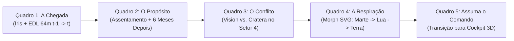
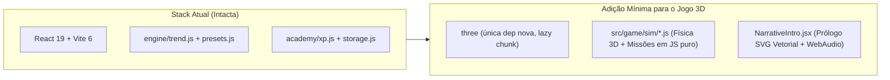
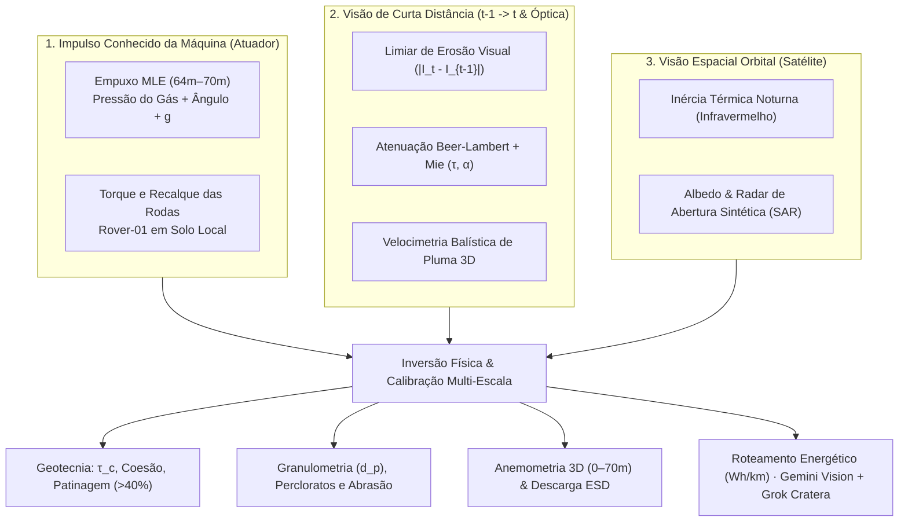

# 🎮 Game Design & Planejamento de Engenharia por Etapas — *Curve of Duck: Rover Pilot 3D*

> [!IMPORTANT]
> **Rigor Científico & Honestidade Auditável (Regra de Ouro do Repositório)**
> Todo o planejamento abaixo separa estritamente:
> 1. **Telemetria Real Congelada no Repositório:** `meda_sol40_wind.csv` (19k linhas de vento em Marte + incerteza + sentinelas `999999999.0`), `meda_sol1100_rad.csv` (58k linhas de fotodiodos RDS do Perseverance), `power_ne_hourly.csv` (série horária NASA POWER), `trend_*.json` (21 séries × 504 meses auditadas por Mann-Kendall Sazonal e Theil-Sen), `firms_br_24h.csv`, `donki_7d.json` e `space_analog.json` (DSN, OSDR OSD-615, CelesTrak, MPTO).
> 2. **Modelo Físico Paramétrico (Explícito no HUD):** Equações físicas reais (atenuação de Beer-Lambert $\exp(-0.55\tau)$, limite de radiador térmico $T^4$, saltação de Bagnold parametrizada por gravidade $g$ e densidade $\rho$, e subtração visual frame a frame $\vert I_t - I_{t-1}\vert$) que aparecem no HUD com o selo `MODELO FÍSICO PARAMÉTRICO (MPTO)`, nunca fingindo ser telemetria bruta.

---

## Parte 1 · Fundamento Científico do Game Design: *"O Planeta Respira"*

A sua visão filosófica e física — **"tudo respira: florestas, oceanos, atmosfera e crosta; e a Curva do Pato somada à visão computacional $t-1 \to t$ permite adaptar o modelo a qualquer gravidade ou atmosfera"** — é o **núcleo perfeito** para unificar a história do jogo com a ciência real do projeto.

### 1.1 Como essa tese vira mecânica de jogo e algoritmo real
Em vez de programar regras artificiais ("se tempo = 10s, crie vento"), o motor do jogo (`game/sim/planetaryPhysics.js`) roda exatamente sob a sua tese em **três camadas acopladas**:

1. **A Respiração Macro (Base Determinística Sazonal e Diurna — Curva do Pato):**
   - Todo corpo planetário tem um ciclo harmônico de inspiração e expiração térmica:
     - **Na Terra (Campinas, Petrolina, Manaus):** Ciclo diurno solar (`power_ne_hourly.csv`) e ciclo sazonal de 42 anos (`trend_*.json`). Ao meio-dia, o planeta "inspira" radiação máxima (`ALLSKY_SFC_SW_DWN`), criando a barriga da Curva do Pato; às 18h, "expira" calor com queda abrupta de geração solar e rampa de carga.
     - **Em Marte (Cratera Jezero):** Ciclo diurno da Camada Limite Planetária (PBL) medido pelo **MEDA** (`meda_sol40_wind.csv` e `meda_sol1100_rad.csv`). O aquecimento do solo dispara plumas convectivas, vórtices (*dust devils*) e rajadas com incerteza instrumental (`HORIZONTAL_WIND_SPEED_UNCERTAINTY`).
2. **O Vetor de Contexto Planetário $\vec{\Theta} = [g, \rho, c_p, \tau_0]$ (Autoadaptação Física):**
   - Quando o jogador muda de bioma ou planeta, a física 3D do rover e das partículas não muda por "código fixo", mas porque o motor recebe o vetor $\vec{\Theta}$ do mundo:
     - **Terra:** $g = 9.81\text{ m/s}^2$, $\rho \approx 1.225\text{ kg/m}^3$ (arrasto denso, convecção úmida).
     - **Marte (Jezero):** $g = 3.71\text{ m/s}^2$, $\rho \approx 0.020\text{ kg/m}^3$ (baixa densidade, saltação de areia em suspensão prolongada, resfriamento radiativo rápido).
     - **Lua (Cratera / Tubo de Lava):** $g = 1.62\text{ m/s}^2$, $\rho = 0\text{ kg/m}^3$ (vácuo, ejeção balística pura, dependência total de radiador térmico $T^4$ e albedo IR de cratera de 10–15% já presente em `SpaceAnalogTab.jsx`).
3. **A Visão Computacional Frame a Frame ($\Delta I = \vert I_t - I_{t-1}\vert$) + Calibração de Risco (P10–P90):**
   - No canto do HUD 3D, o jogador vê o **Feed da Câmera de Navegação (NavCam)** do rover.
   - O motor calcula em tempo real a derivada temporal entre o frame anterior ($t-1$) e o frame atual ($t$) dos sensores ópticos (usando os canais laterais vs. topo `RDS_LAT_1..8` e `RDS_TOP_1..8` do `meda_sol1100_rad.csv` e o fluxo de partículas na tela).
   - Isso ensina na prática o que você descreveu: **a curva histórica diz *quando* a janela de perigo se abre; a banda de incerteza mede o *tamanho* do risco; e o salto em $\vert I_t - I_{t-1}\vert$ crava o *instante exato* em que a tempestade, a fumaça ou a pluma de pouso começou.**

---

## Parte 2 · Abertura Narrativa Interativa (Prólogo Clicável em SVG Vetorial — Zero Vídeo)

Como você definiu, **não usaremos arquivo de vídeo MP4** (que deixaria o repositório pesado e estático). Vamos construir o componente `NarrativeIntro.jsx` usando **cenas vetoriais SVG animadas em camadas (parallax + CSS/SVG morphing) + sintetizador de áudio Web Audio API nativo** (zero arquivos externos de som, gerando o som grave dos propulsores, vento marciano e bipes de telemetria direto no navegador).

O próprio repositório já tem a função `smoothCurvePath` e `interpolatePoints` em [story.js](file:///c:/Users/Usuario/OneDrive/Área%20de%20Trabalho/Hackaton_NASA/cockpit-omni/Curva_do_Pato/frontend/src/content/story.js#L288-L313) — vamos reutilizar essa mesma matemática para fazer a malha topográfica se transformar (*morph*) entre Marte, Lua e Terra!

### Decupagem Interativa: Os 5 Quadros Clicáveis (Botão `Avançar ▸` / `Pular Prólogo ⏭`)



| Quadro | Visual SVG Vetorial Animado (100% Código) | Texto Narrativo / Diálogo na Tela | Conexão Científica que Prepara o Jogo |
|---|---|---|---|
| **1. A Chegada (EDL)** | Close vetorial estilizado de um capacete/olho refletindo Marte vermelho. Ao mover o mouse ou clicar, o reflexo abre para a nave descendo a **64 m do solo**. Um mini-indicador `\|I_t - I_{t-1}\|` dispara quando o jato levanta a pluma de regolito; o computador trava nos *landmarks* externos e pousa. | *"Tudo no universo respira. Para pousar vivos em Marte, precisamos ler essa respiração frame a frame ($t-1 \to t$) antes que a poeira dos nossos próprios motores cegue os sensores."* | Introduz a **Visão Computacional $t-1 \to t$** e a janela de pouso (EDL) na camada limite planetária. |
| **2. O Propósito (`6 MESES DEPOIS`)** | Contraluz vetorial laranja-acinzentado: a rampa se abre, silhuetas humanas (uma família de colonos/pesquisadores) caminham rumo aos domos habitacionais interligados por cabos de energia e estufas (`SoC_bio`). Corte tipográfico minimalista: **`6 MESES DEPOIS · CRATERA JEZERO`**. | *"Seis meses após o pouso, gráficos deixaram de ser teoria. Quando a curva de energia cai ou o vento sobe, é o oxigênio e o aquecimento dos domos que estão em jogo."* | Estabelece **o que está em jogo** (sobrevivência humana e infraestrutura crítica). |
| **3. A Central de Comando (Fusão de Agentes)** | Sala escura do cockpit com malha topográfica 3D vetorial. Uma frente laranja de poeira avança pelo Setor 4 enquanto a curva solar despenca. Dois alertas piscam em conflito: Rota Alpha (vermelha, bloqueada por falha geométrica) vs. Rota Segura (vetor verde recalculado). | **Operador Óptico:** *"O sensor óptico RDS detectou salto de poeira ($\Delta I$) no Setor 4! Recolher rover para a Posição Alpha!"*<br>**Operador Topográfico:** *"Negativo! O radar topográfico aponta anomalia geométrica na cratera Alpha — o rover ficaria sem linha de visada solar!"*<br>**Sistema OMNI:** *"Fusão concluída: nova rota segura traçada."* | Ensina na história por que **um único indicador falha** (visão atmosférica + geometria do terreno + reserva de bateria precisam convergir). |
| **4. A Respiração Unificada (Marte → Lua → Terra)** | A curva topográfica faz um *morph* suave (usando `interpolatePoints`) da Cratera Jezero para o Polo Sul Lunar e depois para os 3 biomas brasileiros (Campinas, Petrolina, Manaus), conectando os pontos por linhas de telemetria. | *"Do ciclo diário de $\text{CO}_2$ em Marte às frentes de chuva e sol no Brasil: a mesma matemática que antecipa o colapso de energia num habitat protege nossas cidades na Terra."* | Conecta Marte de volta ao dataset principal do hackathon (**NASA POWER 42 anos + MEDA + MPTO**). |
| **5. Transferência de Comando** | O SVG da central se abre como uma viseira e revela o **Cenário 3D ao vivo** ao fundo. O botão principal pulsa: **`[ INICIAR SIMULAÇÃO 3D · ASSUMIR ROVER ]`**. | *"Comandante, você está no controle manual do Rover-01. Leia os gráficos reais da NASA, observe a curva subir e aja antes do ponto crítico."* | Transição sem tela de carregamento para o Gameplay 3D. |

---

## Parte 3 · Mecânicas do Rover 3D e o Loop "Dado Sobe → Ação Física"

Para que o jogo seja **3D, intuitivo e focado no aprendizado estatístico**, o jogador não precisa de controles complexos de simulador de voo. Ele precisa de **movimentação espacial clara + 5 ações físicas de engenharia** que respondem diretamente ao gráfico.

### 3.1 Controles e Ações Físicas do Rover no Plano 3D

| Tecla / Botão HUD | Ação Física do Rover em 3D (Animação Visível) | Efeito Físico na Simulação (`roverModel.js`) | Quando usar (Gatilho de Dados) |
|---|---|---|---|
| **Setas / WASD** | Dirige pelas colinas, crateras, sombras e estações; a suspensão inclina conforme a normal do terreno 3D. | Consome energia de locomoção ($\text{Wh/km}$ parametrizado pela gravidade $g$ e inclinação do solo). | Posicionar em cristas iluminadas, buscar abrigo topográfico ou ir até estações. |
| **`[1]` Abrir / Fechar Asas Solares** | Os painéis solares articulados se abrem em leque (captando sol) ou se dobram sobre o chassi (*Stow*). | **Aberto:** gera energia $\propto \text{Irradiância} \times \exp(-0.55\tau)$, mas sofre arrasto de vento e acúmulo de poeira.<br>**Fechado:** geração = 0, mas protege contra sobretensão e quebra por rajada. | **Fechar:** no pico da Curva do Pato sem demanda (evitar sobrecarga) ou antes de rajada severa.<br>**Abrir:** quando a radiação é segura. |
| **`[2]` Abaixar / Erguer Suspensão e Mastro** | O chassi hidráulico abaixa rente ao chão (*Hunker Down*) ou ergue o mastro óptico/anemômetro a 2m de altura. | **Abaixado:** reduz área exposta ao vento em 60% e trava rodas no solo.<br>**Erguido:** amplia o alcance da câmera $t-1 \to t$ e mede vento livre a 2m (`WS2M`). | **Abaixar:** durante passagem de frente de vento/vórtice.<br>**Erguer:** para escanear o horizonte e medir tendência sem bloqueio de rochas. |
| **`[3]` Inclinar Painel (Limpeza Eólica / Ângulo Solar)** | Os painéis inclinam a $35^\circ$ a favor do vento ou do sol baixo. | Se o vento estiver na faixa moderada ($8\text{–}14\text{ m/s}$), o fluxo de ar remove a poeira acumulada (*wind cleaning*) sem danificar a estrutura. | Quando o painel está sujo (*soiling*) e o gráfico mostra uma brisa moderada subindo. |
| **`[4]` Purga / Saneamento Óptico ($t-1 \to t$)** | Pulso eletrostático na lente da NavCam + filtro de rejeição de sentinelas (`999999999.0`). | Limpa o embaciamento da câmera 3D e descarta leituras nulas/corrompidas do sensor MEDA antes de tomar decisão. | Quando o gráfico e a tela piscam com flags de erro `999999999.0` ou poeira na lente. |
| **`[5]` Acoplar Cabo / Despacho Térmico ($T^4$)** | Conecta o cabo de alta tensão na Estação BESS / Habitat ou reduz o processamento de bordo. | Escoa o excesso solar para a bateria térmica de regolito sinterizado ou corta carga antes do radiador $T^4$ saturar ($\ge 82\%$). | Na barriga da Curva do Pato (meio-dia) ou na rampa noturna do habitat. |

### 3.2 Como funciona o "Nivelamento das Curvas" durante cada Missão

Você pediu especificamente: *"a hora que aparece a missão na tela, apresenta o texto informando a missão e o objetivo. Em seguida, vem o gráfico com a estimativa. Como tem nivelamento, tem que ter as curvas subindo mostrando a identificação, depois pedindo a ação do rover"*.

Para isso funcionar de forma cristalina, cada missão segue um **Ciclo de 4 Fases no HUD**:

```mermaid
sequenceDiagram
  participant J as Jogador (Rover 3D)
  participant H as HUD Narrativo & Gráfico
  participant S as Motor de Dados Reais (Sim)

  Note over J,S: FASE A — BRIEFING DE CAMPO (3 segundos ou clique)
  H->>J: Card da Missão: Contexto científico + Objetivo claro + Qual variável observar
  Note over J,S: FASE B — CURVA SUBINDO & NIVELAMENTO (Explorando o terreno)
  S->>H: Alimenta pontos reais (tick a tick) no gráfico ao vivo
  H->>J: Mostra a Linha Base / Estimativa (Média, Limiar ou Banda P10-P90)
  Note over J,S: FASE C — IDENTIFICAÇÃO DO GATILHO & JANELA DE AÇÃO
  S->>H: A curva real cruza o patamar de nivelamento (ou salta em t-1 -> t)
  H->>J: Alerta Visual + Sonoro: "IDENTIFICADO: [Fenômeno]! Execute: [Ação do Rover + Posição 3D]"
  J->>S: Dirige no terreno 3D (cratera/rocha/estação) + Aciona comando (Fechar/Abaixar/etc.)
  Note over J,S: FASE D — CONSEQUÊNCIA FÍSICA & DEBRIEF AUDITÁVEL
  S->>J: Clima 3D reage (sol/vento/poeira); calcula energia/integridade e compara com o Ótimo
```

E o **Nivelamento Pedagógico (Level 1 → Level 2 → Level 3)** muda **como o gráfico é lido** naquela mesma missão:
- **Nível 1 · Explorer (Leitura Direta da Curva):** O gráfico mostra a curva real subindo e uma **linha horizontal clara de limite**. Quando a curva passa da linha, o HUD avisa a ação.
- **Nível 2 · Analyst (Estimativa + Margem de Incerteza):** O gráfico mostra a **estimativa esperada (média/mediana)** e a **sombra de incerteza (`_UNCERTAINTY` ou IC 95%)**. O jogador precisa agir quando o *limite superior da incerteza* cruza o risco — antes que seja tarde.
- **Nível 3 · Specialist (Significância + Falsificação Multi-Série):** Duas curvas sobem juntas (ex.: `ALLSKY` vs `CLRSKY`, ou Vento Mensal `p = 0.489` vs Rajada MEDA 1 Hz, ou $\vert I_t - I_{t-1}\vert$). O jogador só deve agir se o sinal for **estatisticamente real** (evitando falso alarme de ruído sazonal).

---

## Parte 4 · As 5 Missões Categorizadas (100% Ancoradas nos Dados do Projeto)

Aqui estão as **5 missões completas**, desenhadas para cobrir tanto o desafio terrestre (Curva do Pato e Tendências de 42 anos da NASA) quanto a fronteira espacial em Marte (MEDA, Visão $t-1 \to t$, EDL e MPTO):

---

### ☀️ Missão 1 · *A Barriga do Pato e o Radiador $T^4$* (Gestão de Pico Solar)
- **Cenário 3D:** Corredor Solar de Petrolina-PE (Análogo Terrestre) conectado à bancada de teste do Habitat Marciano. Terreno aberto com Dunas/Colinas, uma **Estação de Bateria Térmica (Regolito Sinterizado)** no vale e uma **Sombra de Rocha** a oeste.
- **Dado Real Utilizado:** `data/power_ne_hourly.csv` (`ALLSKY_SFC_SW_DWN` e `T2M` hora a hora) + equação real de saturação térmica $T^4$ de `SpaceAnalogTab.jsx` (`thermalLoadPct >= 82%`).
- **Como o Gráfico Sobe:** O relógio avança das 06:00 às 18:00. A curva de irradiância sobe rápido rumo ao meio-dia enquanto a curva de demanda líquida afunda (formando a **barriga da Curva do Pato**), e a temperatura do radiador se aproxima do teto de 82%.
- **Ações Exigidas do Rover:**
  1. Ao identificar a rampa de excesso ao meio-dia: dirigir até a **Estação de Regolito Sinterizado** e apertar **`[5]` Acoplar Cabo** para descarregar o excedente solar antes que o inversor sofra *curtailment* ou sobretensão.
  2. Se estiver longe da estação quando o radiador atingir 82%: apertar **`[1]` Fechar Painéis Solares** ou estacionar na **Sombra da Rocha** para resfriar.
  3. Às 16:30 (quando o sol cai rápido — o "pescoço do pato"): **Reabrir Painéis `[1]`** no topo da colina leste para capturar os últimos raios de sol.
- **Conceito Ensinado:** Ciclo diurno (Curva do Pato), *curtailment*, limite termodinâmico $T^4$ e arbitragem espacial de energia.

---

### 💨 Missão 2 · *Caçador de Rajadas e o Nulo Honesto* (Vento, Incerteza e Abrigo Topográfico)
- **Cenário 3D:** Cratera Jezero, Marte (com comparação espelhada para Campinas/Petrolina). Terreno com uma **Crista Exposta** (onde o rover coleta dados), um **Afloramento Rochoso (Abrigo de Barlavento)** e uma **Pequena Cratera**.
- **Dado Real Utilizado:** `data/meda_sol40_wind.csv` (`HORIZONTAL_WIND_SPEED` + `HORIZONTAL_WIND_SPEED_UNCERTAINTY` medidos pelo Perseverance no Sol 40) contrastado com `trend_campinas_WS2M.json` ($p = 0.489$, tendência mensal nula).
- **Como o Gráfico Sobe:**
  - Primeiro, o briefing mostra a pegadinha científica do projeto: na média mensal (`WS2M`), o vento parece calmo e sem tendência ($p = 0.489$).
  - Mas quando o jogador liga o sensor de alta frequência do rover (**`[2]` Erguer Mastro**), o gráfico em tempo real do **MEDA Sol 40** começa a subir com sua **banda de incerteza (`_UNCERTAINTY`)**!
- **Ações Exigidas do Rover:**
  1. **Fase de Limpeza (*Wind Cleaning*):** Enquanto o vento sobe na faixa moderada, apertar **`[3]` Inclinar Painel** para deixar a brisa marciana limpar a poeira acumulada nos painéis (+geração gratuita!).
  2. **Fase de Alerta Crítico:** Quando o **limite superior da faixa de incerteza** cruza o limiar estrutural de segurança, uma frente de partículas 3D avança pelo cânion.
  3. O jogador tem 12 segundos para **dirigir para trás da Rocha de Abrigo (ou entrar na depressão da Cratera)**, apertar **`[1]` Fechar Asas Solares** e **`[2]` Abaixar a Suspensão** até a rajada passar.
- **Conceito Ensinado:** Por que médias mensais ($p = 0.489$) não preveem extremos de segundos; como tomar decisões pelo limite superior da incerteza (`_UNCERTAINTY`); e como usar a física do vento a seu favor antes do pico destrutivo.

---

### 🌫️ Missão 3 · *Visão Cega em Marte: $t-1 \to t$ e Sentinelas `999999999.0`* (Poeira, EDL e Qualidade de Dados)
- **Cenário 3D:** Setor 4 da Cratera Jezero (exatamente o cenário do Ato 3 da sua abertura!). O rover precisa escoltar o sinal de baliza para o pouso de suprimentos (EDL) atravessando um campo de dunas e crateras.
- **Dado Real Utilizado:** `data/meda_sol1100_rad.csv` (fotodiodos `RDS_TOP_1..8` vs `RDS_LAT_1..8` do Perseverance no Sol 1100) + as flags reais de erro `999999999.0` e `ROVER_STILL` presentes nos CSVs do MEDA.
- **Como o Gráfico Sobe:**
  - Duas curvas sobem no HUD: a **Diferença Visual Frame a Frame ($\Delta I = \vert I_t - I_{t-1}\vert$)** calculada da câmera/sensores laterais e a **Opacidade Óptica ($\tau$)**.
  - De repente, o gráfico dá um salto absurdo para `999999999.0`! (É uma falha real de leitura do sensor, não uma tempestade). Segundos depois, a razão entre os sensores laterais (`RDS_LAT`) e o sensor do topo (`RDS_TOP`) realmente dispara — uma nuvem real de poeira (*dust devil* / pluma a 64 m) está cegando a câmera 3D!
- **Ações Exigidas do Rover:**
  1. Quando aparece o pico `999999999.0`: **NÃO entrar em pânico nem abortar a missão** — apertar **`[4]` Saneamento Óptico / Filtro de Sentinela** para limpar o valor nulo e manter o rover na rota (ensinando o módulo M5 da Academy: *dado ausente ≠ catástrofe*).
  2. Quando a derivada real $\vert I_t - I_{t-1}\vert$ sobe e a neblina laranja fecha a visão 3D ($\tau > 1.8$): o alerta do *Operador 2 (Grok Cratera)* avisa que a Posição Alpha à frente é uma cratera íngreme sem saída!
  3. O jogador usa o **radar de contorno no HUD** para desviar da cratera perigosa, estacionar no platô seguro (**Rota Verde**), **parar o rover (`ROVER_STILL = 1`)** para estabilizar a leitura óptica e travar o farol de pouso.
- **Conceito Ensinado:** Subtração de frames $t-1 \to t$, diferença entre falha de sensor (`999999999.0`) e evento físico real, fusão sensorial (visão óptica + geometria de cratera) e lei de atenuação de Beer-Lambert.

---

### 🔍 Missão 4 · *O Enigma das Duas Fumaças: Campinas vs. Manaus* (Mann-Kendall, Theil-Sen e Falsificação Causal)
- **Cenário 3D:** Simulador Comparativo de Biomas (viagem acelerada pelas 4 décadas: 1984 → 2025). O terreno 3D divide-se em estações de coleta onde o clima visual responde aos 504 meses reais.
- **Dado Real Utilizado:** `trend_campinas_ALLSKY_SFC_SW_DWN.json`, `trend_campinas_CLRSKY_SFC_SW_DWN.json` ($\tau = +0.322$, $p < 10^{-16}$), `trend_campinas_CLOUD_ATTEN_PCT.json` ($p = 0.948$, nulo), `trend_manaus_CLOUD_ATTEN_PCT.json` ($-0.855\text{ \%/déc}$) e `firms_br_24h.csv` (focos VIIRS).
- **Como o Gráfico Sobe:**
  - À medida que o rover avança pelos marcos de 1984, 1995, 2005, 2015 e 2025, a curva bruta parece um ziguezague confuso (inverno/verão — o teste ingênuo dá $p = 0.197$, "sem tendência").
  - Ao coletar os balizadores sazonais pelo cenário, o jogador ativa o **Mann-Kendall Sazonal (período = 12)**: a oscilação de verão/inverno se nivela e a **inclinação real de Theil-Sen** emerge subindo na tela!
- **Ações Exigidas do Rover:**
  1. **Erguer Mastro `[2]`** nos 3 pontos de amostragem para destravar o filtro sazonal e revelar que a radiação subiu de verdade ($p = 0.00086$).
  2. **Desafio de Falsificação Física (O Clímax Científico):** O sistema pergunta *por que* o sol aumentou. Duas rotas se abrem no terreno 3D: **Estação Nuvens** vs. **Estação Aerossóis/Céu Limpo**.
  3. Olhando as duas curvas subindo (`CLOUD_ATTEN_PCT` estável com $p = 0.948$ vs. `CLRSKY` subindo com $p < 10^{-16}$ em Campinas, ao contrário de Manaus), o jogador deve conduzir o rover até a **Estação correta de cada bioma** e acionar a coleta **`[5]`**.
- **Conceito Ensinado:** Por que a sazonalidade esconde tendências (M1), inclinação de Theil-Sen com IC 95% (M3) e atribuição causal por falsificação entre nuvens e aerossóis (M4).

---

### 🛡️ Missão 5 · *Tempestade Conjugada: Clima Espacial DONKI + Sobrevivência Noturna* (Orquestração Multi-Física MPTO)
- **Cenário 3D:** Fronteira Marte / Polo Sul Lunar (Orquestração Completa MPTO com Cratera Iluminada, Estufa Biológica `OSD-615` e **Tubo de Lava Subterrâneo**).
- **Dado Real Utilizado:** `public/cache/donki_7d.json` (8 eventos solares reais da NASA: alertas RBE/CME), `horizons_mars_sun.json`, `space_analog.json` (OSDR `OSD-615` `SoC_bio`, antenas `DSN Now` Goldstone/Madrid/Canberra e as 7 fronteiras MPTO).
- **Como o Gráfico Sobe:**
  - Três curvas sobem/descem simultaneamente no painel mestre:
    1. **Fluxo de Alerta Solar (`DONKI`)** subindo rumo ao pico geomagnético/radiação;
    2. **Irradiância Solar** caindo para o eclipse/noite marciana;
    3. **Reserva Vital do Habitat (`Bateria Química + Reserva Biológica SoC_bio`)** aproximando-se do piso crítico.
- **Ações Exigidas do Rover (Missão Mestre):**
  1. **Despacho Antecipado (30–60 min antes da rampa):** Antes que o sol se ponha e a onda do DONKI chegue, dirigir até a **Borda Iluminada da Cratera** com **`[1]` Painéis Abertos** e **`[3]` Inclinados** para aproveitar os **+10–15% de ganho de Albedo IR da cratera** e carregar a bateria ao máximo.
  2. Descer até a **Estufa / Habitat** e apertar **`[5]` Acoplar Cabo** para transferir energia e proteger o piso biológico (`SoC_bio` de celulose da *Arabidopsis thaliana* OSD-615).
  3. Quando a curva do **DONKI** cruza o alerta vermelho: **recolher os painéis `[1]`, abaixar o mastro `[2]` e conduzir o rover para dentro do Tubo de Lava Subterrâneo** antes do impacto da tempestade solar.
- **Conceito Ensinado:** Tomada de decisão multi-variável sob pressão (energia + térmica + biológica + clima espacial) e despacho preditivo com antecedência de atuadores (Fronteiras 3, 4, 5 e 6 do MPTO).

---

## Parte 5 · Planejamento do Desenvolvimento de Software por Etapas (e Avaliação da Stack)

### 5.1 Verificação Técnica da Stack Atual: Suporta ou Mudamos?

Analisei o `frontend/package.json` (`react: ^19.1.0`, `vite: ^6.3.5`, `lucide-react: ^0.511.0`) e o `styles.css`.
- **Diagnóstico:** A stack atual **NÃO precisa ser trocada**, mas precisa de **um ajuste cirúrgico na forma de integrar o 3D**:
  - **Atenção técnica importante sobre React 19:** A biblioteca `@react-three/fiber` (v8) teve conflitos de *peerDependencies* com o React 19, e o pacote de física WASM (`@react-three/rapier`) adiciona ~1.8 MB de WebAssembly e pode travar o build em ambientes sem suporte a WASM workers.
  - **A Solução mais limpa, rápida e à prova de falhas para o nosso React 19 + Vite 6:**
    Usar **`three` puro encapsulado num componente React (`RoverViewport3D.jsx`) com `useRef` + `requestAnimationFrame`**, exatamente como vocês já fizeram com `DiplomaCanvas.jsx` e `TrendChart.jsx`!
  - **Por que `three` direto é superior aqui?**
    1. **100% compatível com React 19** (zero conflito de reconciler ou `--legacy-peer-deps`).
    2. **Apenas 1 pacote novo (`three`)** — leve, carrega via dynamic `import("three")` apenas quando o usuário abre `/game`.
    3. **Física de Terreno + Rover em Matemática Pura (`roverPhysics.js`):** Usando um *Heightfield* analítico/bilinear $z = h(x, y)$, calculamos a altura das 4 rodas, a inclinação (*pitch* e *roll*) do chassi, as zonas de sombra/abrigo e a colisão com crateras em **menos de 0.2 ms por frame em JS puro**, sendo 100% testável em Node (`node --test`) junto com os demais testes do repositório!



### 5.2 Cronograma de Engenharia em 6 Etapas (Do Zero ao Jogo Completo)

Cada etapa abaixo foi desenhada para ser **autocontida, verificável com `vite build` e testada com `node --test`**:

| Etapa | Escopo de Engenharia de Software | Arquivos Criados / Modificados | Como Validamos |
|---|---|---|---|
| **Etapa 1 · Motor Físico-Científico & Dados das 5 Missões (`game/sim`)** | Criar o vetor planetário $\vec{\Theta}$, a física 3D de terreno/rover (altura $h(x,y)$, inclinação 3D, energia, temperatura $T^4$, vento, poeira $\tau$, derivada $t-1 \to t$), o extrator das séries reais (M1–M5) e o nivelamento Explorer/Analyst/Specialist. | `src/game/sim/planetaryPhysics.js`<br>`src/game/sim/roverState.js`<br>`src/game/missions/missionDefs.js`<br>`src/game/sim/sim.test.mjs` | Rodar `node --test` garantindo que todas as 5 missões usam os valores reais auditados do repositório. |
| **Etapa 2 · Abertura Narrativa Vetorial (`NarrativeIntro.jsx`)** | Construir os 5 quadros clicáveis em SVG vetorial animado (Olho/Pouso 64m → Família/6 Meses Depois → Conflito Setor 4 Vision vs. Cratera → Morph Marte-Lua-Terra → Cockpit) + efeitos sonoros sintetizados via Web Audio API (com botão Mute). | `src/game/NarrativeIntro.jsx` | Testar cliques de avanço, morph suave das curvas SVG, responsividade e botão "Pular para o Jogo 3D". |
| **Etapa 3 · Mundo 3D Interativo & Rover Articulado (`RoverViewport3D.jsx`)** | Construir a cena Three.js com câmera em 3ª pessoa que acompanha o rover, terreno 3D com relevo (crateras, rochas de abrigo, colinas, estação BESS, estufa e tubo de lava), rover 3D com **asas solares que abrem/fecham/inclinam e mastro/suspensão que sobe/abaixa**, sol dinâmico e partículas 3D de vento/poeira. | `src/game/RoverViewport3D.jsx` | Pilotar o rover em 60 FPS pelas setas/WASD e ver cada animação física (`[1]` a `[5]`) acontecer em 3D. |
| **Etapa 4 · HUD Científico, Gráfico Subindo em Tempo Real e Câmera $t-1 \to t$** | Criar o painel superior/inferior que exibe o briefing da missão, o **gráfico subindo ao vivo com as linhas de nivelamento e bandas de incerteza**, o visor da NavCam com a métrica $\vert I_t - I_{t-1}\vert$ e os botões de ação do rover. | `src/game/MissionHud.jsx`<br>`src/game/LiveMissionChart.jsx` | Verificar que a curva sobe sincronizada com o sol/vento 3D e dispara o pedido de ação no momento exato. |
| **Etapa 5 · Debrief Comparativo + Integração de XP, Badges e Rota `/game`** | Tela de fechamento de cada missão comparando **Sua Ação vs. Política Ótima vs. Estatística Oficial da NASA**, gravando estrelas (`starsFor`) e XP (`xpFor`) no mesmo perfil da Academy (`storage.js`) e desbloqueando o **Mission Lab** (escolha livre de dificuldade) após a M5. | `src/pages/GamePage.jsx`<br>`src/App.jsx`<br>`src/components/AppShell.jsx`<br>`src/academy/xp.js`<br>`src/content/i18n.js` | Completar missões, ver o XP subir no Hall of Fame e alternar entre Story, Academy, Cockpit e Game sem perder estado. |
| **Etapa 6 · Auditoria Final de Qualidade, Contraste e Build** | Rodar todos os testes automatizados (`trend.test.mjs`, `mastery.test.mjs`, `story.test.mjs`, `sim.test.mjs`) e `vite build` de produção. | Suite completa de testes | Zero erros de build e 100% dos testes científicos passando. |

---

## Parte 6 · Inversão Física por Resposta ao Impulso e Transferência Multi-Escala (*Active Impulse-Response Inversion & Orbital-to-Surface Calibration*)

No **Ato 1** da abertura narrativa (`00:00 – 00:04`), quando o módulo aciona os retrofoguetes para pousar a $64\text{ m}$ de altitude e a câmera filma a poeira subindo ([como nas gravações reais das câmeras MARDI do Curiosity e RDC do Perseverance — AIAA 10.2514/1.A35748](https://arc.aiaa.org/doi/10.2514/1.A35748)), aquilo **não é apenas uma cena cinematográfica de chegada** — é um **ensaio físico controlado por resposta ao impulso sobre um planeta desconhecido**.

Como o sistema conhece exatamente o vetor de entrada do motor (empuxo da turbina, pressão do gás, velocidade de descida, ângulo do veículo e gravidade local $g$), ao medir com visão computacional frame a frame ($t-1 \to t$) como a poeira subiu e espalhou a luz, e cruzar esse ponto com a visão espacial de longa distância (satélites em órbita), o motor resolve a equação inversa e extrai a resistência mecânica do solo, a granulometria/química da poeira e o comportamento geotécnico oculto do terreno a dezenas de quilômetros de distância.



---

### 6.1 As 4 Diretrizes de Cálculos Extraídas do Cruzamento Multi-Escala

#### Diretriz 1 — Cálculo Geotécnico Inverso (Empuxo do Motor $\times$ Início da Erosão Visual $t-1 \to t$)
- **Fundamento empírico:** Nos dados de descida do Curiosity e do Perseverance ([*Observed High-Altitude Surface Erosion During MSL Landing* — AIAA](https://arc.aiaa.org/doi/10.2514/1.A35748)), os motores *Mars Lander Engines* (MLE) começam a varrer o solo a uma altitude de **64 a 70 metros**, onde o fluxo dinâmico do jato na superfície atinge cerca de $80\text{ kg}/(\text{m}\cdot\text{s}^2)$.
- **Equação de inversão física:** Sabendo a pressão exata do jato do foguete a cada metro de altitude ($h$) e detectando na câmera exatamente em qual milissegundo ($t-1 \to t$) os grãos começaram a se mover, igualamos a tensão de cisalhamento do jato ($\tau_{\text{jato}}$) à **Tensão Crítica de Cisalhamento do Solo ($\tau_c$)**:
  $$\tau_{\text{jato}}(h, \theta) = \frac{1}{2}\rho_{\text{gás}} v_{\text{jato}}^2 \ge \tau_c(\text{coesão}, d_p, g)$$
- **O que isso entrega ao sistema:**
  1. **Coesão e Resistência Mecânica do Solo (Geotecnia):** Se a poeira levanta cedo demais (ex.: a $70\text{ m}$), o solo é fino, solto e sem coesão (alto risco de atolamento para o rover). Se demora a levantar e abre uma cratera rasa sob o jato, há uma camada dura (*duricrust* ou rocha matriz) logo abaixo da areia.
  2. **Compactação e Capacidade de Carga:** Calcula se o terreno aguenta o peso dos domos habitacionais e módulos de pouso do **Ato 2** sem recalque diferencial ou afundamento.

#### Diretriz 2 — Espalhamento de Luz e Espectroscopia Óptica (Cor, Densidade e Química da Poeira)
- **Fundamento empírico:** Quando a nuvem de poeira sobe sob o motor (ou atrás das rodas do rover), a luz do Sol atravessa essa cortina antes de chegar à lente da câmera.
- **Equação de inversão física:** Aplicando a **Lei de Beer-Lambert** combinada à **Teoria de Espalhamento de Mie** (que relaciona o comprimento de onda da luz $\lambda$ ao raio da partícula $r_p$):
  $$I(\lambda) = I_0(\lambda) \cdot e^{-\tau(\lambda)}$$
  Medindo a perda de contraste entre os canais Vermelho, Verde e Azul (RGB / multiespectral) entre os quadros $t-1$ e $t$, calculamos o **Expoente de Ångström ($\alpha$)**:
- **O que isso entrega ao sistema:**
  1. **Granulometria Exata ($d_p$):** Partículas gigantes (areia grossa, $>100\,\mu\text{m}$) bloqueiam todos os comprimentos de onda por igual (sombra cinza/opaca e queda rápida). Partículas micrométricas (sílica fina e óxido de ferro, $1\text{ a }5\,\mu\text{m}$) espalham fortemente o vermelho/infravermelho e ficam suspensas.
  2. **Mineralogia e Toxicidade:** A razão espectral da luz refletida na pluma revela a proporção de hematita/magnetita (poeira magnética que gruda em painéis solares e juntas mecânicas) e sais oxidantes (percloratos tóxicos para a equipe humana nas estufas `OSD-615` do Ato 2).
  3. **Taxa de Abrasão Mecânica:** Grãos angulares e densos geram um padrão de reflexão especular diferente de grãos arredondados, permitindo prever o desgaste das juntas do rover.

#### Diretriz 3 — Decaimento Balístico-Gravitacional e Anemometria de Pluma (Física Atmosférica 3D)
- **Fundamento empírico:** Depois que o motor sopra a poeira para o alto (ou quando o rover freia), o jato cessa e a nuvem de partículas passa a obedecer unicamente à gravidade local ($g$), ao arrasto da atmosfera ($\rho_{\text{atm}}$) e ao vento lateral ($\vec{v}_{\text{vento}}$).
- **Equação de inversão física:** Rastreamos a velocidade de subida e queda da borda da pluma via *Optical Flow* ($t-1 \to t$):
  $$m_p \frac{d\vec{v}_p}{dt} = m_p \vec{g} + \frac{1}{2} C_D \rho_{\text{atm}} A_p \lvert\vec{v}_{\text{vento}} - \vec{v}_p\rvert(\vec{v}_{\text{vento}} - \vec{v}_p) + \vec{F}_{\text{eletrostática}}$$
- **O que isso entrega ao sistema:**
  1. **Perfil Vertical de Vento (Anemômetro Virtual de 0 a 70 m):** O sensor MEDA do rover só mede o vento a $1,5\text{ m}$ do chão. Mas a pluma do pouso sobe a dezenas de metros! Ao ver a cortina de poeira entortar em diferentes alturas nos quadros de vídeo, o computador reconstrói a **cisalha de vento (*wind shear*) e a turbulência** em toda a coluna de ar.
  2. **Carga Eletrostática ($\vec{F}_{\text{eletrostática}}$ / Triboeletricidade):** Em Marte e na Lua, o atrito entre grãos de poeira no jato gera milhares de volts de eletricidade estática. Quando grãos finos não caem na velocidade prevista pela gravidade + arrasto, a diferença revela a força eletrostática — crítica para proteger a eletrônica da base contra descargas (ESD) e prever a adesão eletrostática nos painéis solares.

#### Diretriz 4 — Calibração Curta Distância $\times$ Longa Distância (Do Jato do Pouso para o Mapa de Satélite)
- **O elo mestre da arquitetura:** Um satélite em órbita (como Mars Reconnaissance Orbiter / HiRISE / THEMIS em Marte, LRO na Lua ou Sentinel/Landsat/MODIS na Terra) enxerga centenas de quilômetros, mas **não consegue tocar o chão** — ele só vê cor (albedo), temperatura superficial (inércia térmica) e rugosidade de radar (SAR).
- **Como o cruzamento funciona (Transferência de Escala):**
  1. No ponto exato do pouso $(x_0, y_0)$, a imagem de satélite mostrava uma mancha de albedo $A_0$ e inércia térmica $I_0$.
  2. Quando o foguete pousou ali (e quando o rover andou os primeiros metros medindo o afundamento da roda e o torque do motor), nós descobrimos a **verdade física absoluta (*Ground Truth*)** daquele pixel: *"Aquele tom de cinza + aquela inércia térmica no satélite equivalem a uma coesão de $\tau_c = 85\text{ Pa}$, grãos de $40\,\mu\text{m}$ e afundamento de roda de $3\text{ cm}$"*.
  3. Além disso, o jato do pouso limpa a poeira superficial ao redor da nave (criando o famoso halo escuro de *ejecta* visto do espaço). Comparando a foto do satélite **antes e depois do pouso**, o sistema mede a espessura exata da camada de poeira solta!
- **Como isso fundamenta matematicamente o diálogo do Ato 3 (e a Missão 3):**
  - Quando o **Gemini Vision** (óptico/atmosfera) olha a tempestade no Setor 4 e sugere a rota pela **Posição Alpha**, o **Grok Cratera** (topografia + satélite calibrado pelo pouso) cruza o mapa orbital de Inércia Térmica com a calibração física feita no Ato 1 e crava:
    > *"Na Posição Alpha, a assinatura de inércia térmica noturna do satélite indica areia eólica não consolidada (baixa coesão $\tau_c$, idêntica à zona de alta erosão medida no teste de empuxo). Se o Rover-01 entrar ali com inclinação de $18^\circ$, a patinagem (*wheel slip*) passará de $40\%$ e a bateria vai zerar antes do abrigo! Rota recalculada pelo platô de basalto compacto (Vetor Verde)."*
  - Ou seja: o mapa deixa de ser um mapa de **distância em metros** e passa a ser um **Mapa de Custo Energético Real em $\text{Wh/km}$** ($1\text{ km}$ em areia fofa na Cratera Alpha custa o mesmo que $1,8\text{ km}$ em rocha firme no Platô Verde!).

---

### 6.2 Matriz Consolidada de Cálculos (As 4 Camadas de Fusão do Ecossistema)

| Camada de Fusão | Entrada da Máquina (Atuador Conhecido) | Visão Curta Distância ($t-1 \to t$ / Rover) | Visão Longa Distância (Satélite / Órbita) | Propriedade Oculta Extraída (O que o sistema descobre) |
| :--- | :--- | :--- | :--- | :--- |
| **1. Propulsão $\times$ Geotecnia** | Empuxo do motor na descida ($F_{\text{motor}}$), torque e recalque das rodas | Raio de início da erosão, profundidade do sulco da roda e volume da pluma | Albedo pós-pouso (halo de *ejecta*) + Inércia Térmica Noturna (Infravermelho) | **Resistência ao cisalhamento ($\tau_c$), coesão do solo, risco de atolamento (*wheel slip*) e capacidade de fundação para a colônia.** |
| **2. Óptica de Dispersão $\times$ Atmosfera** | Posição/ângulo da câmera, espectro da luz solar incidente e faróis LED do rover | Atenuação espectral RGB ($\Delta I_\lambda$) e velocidade de queda da cortina de poeira | Profundidade óptica orbital ($\tau_{\text{sat}}$) e evolução regional da frente de poeira | **Tamanho médio do grão ($d_p$), concentração de ferro/percloratos, taxa de deposição nos painéis (*soiling*) e carga eletrostática.** |
| **3. Gravitacional $\times$ Geofísica e Cataclismos** | Aceleração inercial (IMU do pouso/rover) e vibração mecânica no chassi | Trajetória parabólica dos detritos ejetados ($g$ local) e deslocamento de blocos | Interferometria de Radar (InSAR / NISAR) e anomalias gravimétricas orbitais | **Estabilidade de encostas/crateras, detecção de cavidades subterrâneas (tubos de lava para abrigo de radiação) e predição de deslizamentos.** |
| **4. Eletrodinâmica $\times$ Manutenção e Carga** | Corrente das placas solares ($I_{PV}$), temperatura do painel ($T_{\text{painel}}$) e consumo de tração | Brilho difuso no céu (*sky glow*) e aderência visual de poeira na lente/painel | Radiação de topo de atmosfera (JPL Horizons / DONKI CME) | **Fator de perda por sujidade (*Soiling Factor*), eficiência térmica real ($T^4$) e orçamento exato de bateria até o próximo abrigo ($\text{Wh/km}$).** |

---

## Parte 7 · Roteirização da Próxima Etapa do Game Design (Integração Narrativa + Gameplay 3D)

Esta síntese alimenta diretamente tanto o **roteiro da abertura interativa (`NarrativeIntro.jsx`)** quanto a **mecânica física em tempo real da Missão 3 (`M3`) e do Debrief Científico**:

### 7.1 Roteiro Técnico-Narrativo Ato a Ato (`NarrativeIntro.jsx`)

1. **Ato 1 (`00:00 – 00:04`) · A Chegada e o Ensaio de Impulso a 64 m:**
   - **Visual SVG:** Íris humana refletindo Marte $\to$ módulo em descida controlada a $64\text{ m}$ de altitude disparando jato MLE contra o regolito $\to$ vetor $\tau_{\text{jato}} = \frac{1}{2}\rho_{\text{gás}}v_{\text{jato}}^2 \ge \tau_c$ calibrando a coesão do solo em tempo real enquanto $\lvert I_t - I_{t-1}\rvert$ trava nos marcos externos.
   - **Texto/Legenda Científica:** *"O pouso a 64 m não é apenas chegada — é um teste físico ativo. Sabendo o empuxo exato do motor e medindo em $t-1 \to t$ quando a poeira levanta ($\tau_{\text{jato}} \ge \tau_c$), o computador descobre a coesão do solo, o tamanho dos grãos ($d_p$) e calibra o mapa orbital de satélite."*
2. **Ato 2 (`00:04 – 00:08`) · O Assentamento sobre Fundação Validada (6 Meses Depois):**
   - **Visual SVG:** Rampa do módulo aberta, família caminhando rumo aos domos pressurizados e estufas `OSD-615` erguidos sobre o platô de alta capacidade de carga validado no pouso.
   - **Texto/Legenda Científica:** *"Seis meses depois, os domos habitacionais e estufas biológicas OSD-615 repousam sobre a rocha matriz que o ensaio de empuxo do Ato 1 mapeou sem risco de recalque diferencial."*
3. **Ato 3 (`00:08 – 00:15`) · O Conflito Sensorial no Setor 4 (Gemini Vision $\times$ Grok Cratera):**
   - **Visual SVG:** Mapa tático do Setor 4 com a frente de poeira avançando, a rota vermelha rejeitada passando pela **Cratera Alpha** (baixa inércia térmica / patinagem $>40\%$) e o **Vetor Verde** contornando pelo platô de basalto compacto.
   - **Diálogo Técnico:**
     - **Operador Óptico (Gemini Vision):** *"Salto de opacidade ($\lvert I_t - I_{t-1}\rvert$, Beer-Lambert $\tau > 1,6$) no Setor 4! Sugerindo abrigo curto pela Posição Alpha!"*
     - **Operador Geotécnico (Grok Cratera):** *"Negativo! Cruzando a inércia térmica noturna do satélite com a calibração de empuxo do pouso ($\tau_c$), a Posição Alpha é areia eólica fofa: inclinação de $18^\circ$ gerará $>40\%$ de patinagem (1 km geométrico = 1,8 km em Wh/km). Redirecionando pelo basalto compacto (Vetor Verde)!"*
4. **Ato 4 (`00:15 – 00:22`) · A Transição Universal Marte $\to$ Lua $\to$ Terra ($\vec{\Theta}$):**
   - **Visual SVG:** Morph contínuo da curva senoidal + equações de transferência $\vec{\Theta} = [g, \rho, c_p, \tau_0]$.
5. **Ato 5 (`00:22 – 00:26`) · Transferência de Comando para o Rover 3D:**
   - **Visual SVG:** Wireframe do Rover-01 armando os 5 subsistemas físicos (`[1]`–`[5]`) e entregando o controle manual em 3ª pessoa ao jogador.

### 7.2 Reflexo Direto na Mecânica da Missão 3 (`M3 · Visão Cega & Cratera Alpha`)
- Na **Missão 3 (`M3`)**, a anomalia da **Cratera Alpha** não causa apenas dano topográfico: se o piloto ignorar o alerta do **Grok Cratera** e entrar no perímetro de baixa inércia térmica da Cratera Alpha, o motor físico aplica:
  1. **Patinagem Geotécnica (*Wheel Slip* $>40\%$):** redução imediata da velocidade efetiva de tração em areia não consolidada ($\tau_c$ baixo);
  2. **Custo Energético Real de $1,8\times\text{ Wh/km}$:** o dreno de locomoção da bateria é multiplicado por $1,8\times$, demonstrando na prática por que o caminho geometricamente mais curto em metros pode esgotar a bateria antes do abrigo.
